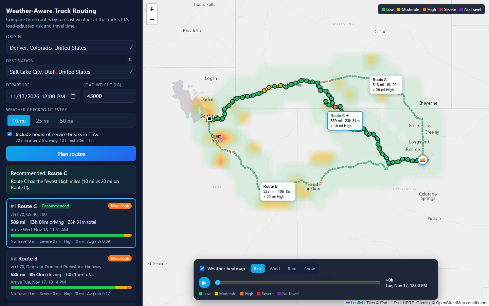

# Weather-Aware Truck Routing

A React + Django app that helps a truck driver pick the safest route. It compares three route options using forecast weather at the truck's **estimated arrival time** at each checkpoint, load-aware risk rules, and travel time.

**Live demo:** _add your hosted URL here_  ·  **Walkthrough:** _add your Loom link here_



## Features

- **Trip inputs:** origin and destination (with autocomplete, or free text, or `lat,lon`), departure date/time, load weight, checkpoint interval (10 / 25 / 50 mi), and an optional hours-of-service (HOS) toggle.
- **3 route options** from OSRM. When OSRM returns fewer than three alternatives, the remaining options are generated with via-points.
- **Weather checkpoints** every 10/25/50 miles. Each one uses the hourly forecast for the hour the truck is expected to reach it.
- **Risk** for each checkpoint from the wind / rain / snow tables plus the load rules. Each route also gets a summary: miles at each risk level, average risk, and worst risk level.
- **Recommendation** using the specified order: fewest Severe miles → fewest High miles → lowest average risk → shortest time. The app also explains why the winner beat the runner-up.
- **Map:**
  - All routes, with the selected route coloured by risk.
  - Checkpoint markers with popups showing ETA, forecast and the factors behind the risk level.
  - Route summary labels on the map.
  - A truck marker that moves along the selected route as the forecast slider changes.
- **Corridor heatmap** for risk, wind, rain or snow, with a **0–48 h slider** and play/pause. Each frame is pre-rendered once, so moving the slider only swaps an image (≈18 ms per step measured in headless Chrome).

## Architecture

```
frontend/  React 19 + TypeScript + Vite + react-leaflet
  src/components/   TripForm, PlaceInput, RouteCards, CheckpointTable, MapView, RouteLayers, HeatmapControls
  src/lib/          heatmapRaster.ts (grid → smooth raster frames), useHeatmap.ts, geo.ts, risk.ts, format.ts
backend/   Django 5 (stateless JSON API, no database)
  planner/domain/   pure logic, no I/O — geo, risk rules, ETA/HOS, checkpoints, recommendation
  planner/services/ OSRM / Open-Meteo / Photon adapters + use cases (planner, heatmap, validation)
  planner/tests/    unit tests for the rules and the ranking
```

Third-party services (all free, no API keys):

| Purpose   | Service                                                       |
|-----------|---------------------------------------------------------------|
| Routing   | [OSRM](https://project-osrm.org) public server                |
| Weather   | [Open-Meteo](https://open-meteo.com) hourly forecast          |
| Geocoding | [Photon](https://photon.komoot.io) (OpenStreetMap data)       |
| Basemap   | Esri World Light Gray canvas                                  |

Upstream responses are cached in memory: weather for 30 min, routes for 6 h, geocoding for 24 h. Requests to the same API are sent in parallel and in batches. As a result, switching the checkpoint interval or re-planning is fast, and the heatmap is not fetched again when only the interval changes.

## How the logic works

### 1. Routes
`services/routing.py` asks OSRM for up to 3 alternatives. At the same time, it requests candidate routes forced through via-points offset to either side of the straight line from origin to destination.

A candidate is accepted only if:
- it takes **≤ 1.6×** the fastest route's time, and
- **< 80 %** of it lies within 1.5 mi of an already chosen route.

If that still gives fewer than three routes (for example, in sparse mountain road networks), a relaxed pass allows up to 2.2× the time and 93 % overlap.

### 2. Travel time and ETA
- **Truck speed:** OSRM's profile is for cars, so each road segment's speed is **capped at 65 mph** (setting `TRUCK_MAX_SPEED_MPH`).
- **HOS rest stops (optional, on by default):** a simplified FMCSA model. The driver takes a 30-minute break after 8 h of driving and a 10-hour rest after 11 h of driving. These stops add to the ETAs, so the weather is sampled for the time the truck is really there.

### 3. Checkpoints and weather sampling
- **Placement:** checkpoints sit at mile 0, N, 2N, … and at the destination.
- **ETA:** each checkpoint's ETA is the departure time plus the time needed to drive to that point (per-segment times interpolated).
- **Forecast hour:** each checkpoint uses the Open-Meteo forecast hour nearest to its ETA (UTC).
- **Rain:** liquid precipitation is `rain + showers` (in/hr).
- **Snow:** `snowfall` (in/hr).
- **Wind:** the sustained 10 m wind speed is used for classification. Gusts are shown for information only.

### 4. Risk rules (`domain/risk.py`)

| Condition | Low | Moderate | High | Severe | No Travel |
|---|---|---|---|---|---|
| Wind (mph) | < 25 | 25–34 | 35–44 | 45–54 | ≥ 55 |
| Rain (in/hr) | < 0.10 | 0.10–0.25 | 0.25–0.50 | 0.50–1.00 | > 1.00 |
| Snow (in/hr) | < 0.5 | 0.5–1.0 | 1.0–2.0 | 2.0–3.0 | > 3.0 |

- **Band boundaries:** the lower bound of each band is inclusive (e.g. 0.25 in/hr rain is High). The table's ">" bounds are exclusive, so 1.00 in/hr rain is still Severe.
- **Load rules, applied to wind:**
  - ≥ 55 mph → No Travel for any load.
  - 45–54 mph with load > 30,000 lb → No Travel.
  - 35–44 mph with load > 40,000 lb → Severe.
- **Checkpoint level:** the worst of the wind, rain and snow levels. The factors that set it are listed in the popup.

### 5. Route risk and recommendation (`domain/recommend.py`)
- **Miles per checkpoint:** each checkpoint stands for the stretch of road halfway to its neighbours. These stretches add up exactly to the route length, so "Severe miles" are real miles.
- **Average risk:** the distance-weighted mean level (Low = 0 … No Travel = 4).
- **Ranking:** routes are compared criterion by criterion, in order:
  1. No Travel miles. These are counted ahead of Severe because they are strictly worse.
  2. Severe miles.
  3. High miles.
  4. Average risk.
  5. Travel time.

  Differences under 0.5 mi or 0.01 average risk count as ties.
- **Warnings:** the UI warns when even the best route crosses No Travel or Severe conditions, or when part of the trip is beyond the forecast horizon.

### 6. Corridor heatmap
- **Grid (backend):** a lat/lon grid over the routes' bounding box. Only nodes within the corridor (≥ 30 mi, or 1.5 cells, of any route) are kept. The grid is made coarser until there are ≤ 220 nodes, which keeps weather-API usage bounded.
- **Data (backend):** for 49 hourly steps from departure, each node gets wind, rain, snow and load-adjusted risk.
- **Rendering (client, `lib/heatmapRaster.ts`):**
  - Values are interpolated bilinearly *before* colour mapping, so there is no colour banding.
  - Rows are placed in Web-Mercator space so the overlay lines up with the basemap.
  - Missing nodes fade out to give soft corridor edges.
  - Each `(layer, hour)` frame is rendered once and cached, and the rest are pre-rendered in idle time.
- **Draw order:** the overlay sits in its own map pane, below place labels and routes.

## Running locally

Requirements: Python 3.12+, Node 20.19+.

```bash
# API (http://127.0.0.1:8000)
cd backend
python -m venv .venv
.venv/Scripts/activate        # Windows  (macOS/Linux: source .venv/bin/activate)
pip install -r requirements.txt
python manage.py runserver

# Frontend (http://localhost:5173, proxies /api to :8000)
cd frontend
npm install
npm run dev
```

Production-style single server: `cd frontend && npm run build`, then `python manage.py runserver`. Django (WhiteNoise) serves `frontend/dist` at `/`.

### Tests and checks

```bash
cd backend && python manage.py test planner     # 27 tests: thresholds, load rules, HOS, checkpoints, ranking
cd frontend && npm run build && npx oxlint src   # strict TypeScript + lint
```

## Deployment

The `Dockerfile` builds the React app, installs the Django API, runs the tests, and serves both from one gunicorn process.

- **Render:** New → Blueprint → select this repo. `render.yaml` sets everything up.
- **Fly.io / Railway / any container host:** deploy the Dockerfile. The app listens on `$PORT`.

Environment variables (all optional):

| Variable | Default | Purpose |
|---|---|---|
| `DJANGO_SECRET_KEY` | dev key | set in production |
| `DJANGO_DEBUG` | `1` locally, `0` in Docker | |
| `DJANGO_ALLOWED_HOSTS` | localhost, `.onrender.com`, `.fly.dev`, `.railway.app` | comma-separated |
| `CORS_ALLOWED_ORIGINS` | `http://localhost:5173` | only needed if the frontend is hosted separately |
| `VITE_API_BASE` | same origin | frontend build-time API URL when hosted separately |
| `OSRM_URL`, `OPEN_METEO_URL`, `PHOTON_URL` | public endpoints | self-hosted alternatives |
| `OPEN_METEO_API_KEY` | – | uses Open-Meteo's commercial endpoint |
| `TRUCK_MAX_SPEED_MPH` | `65` | truck speed cap |

## API

| Method | Path | Body / query | Returns |
|---|---|---|---|
| GET | `/api/geocode?q=…` | | `[{label, lat, lon}]` |
| POST | `/api/plan` | `{origin, destination, departure (ISO), load_lbs, interval_mi: 10\|25\|50, hours_of_service}` | routes (geometry, risk segments, checkpoints with ETA, weather and risk, summary, rank) + recommendation |
| POST | `/api/heatmap` | `{routes: [[[lat,lon],…]], departure, load_lbs}` | corridor grid, nodes and 49 hourly values for each field |
| GET | `/api/health` | | `{status: "ok"}` |

`origin` and `destination` accept either `{label, lat, lon}` or a free-text string. Errors return `{error}` with HTTP 400 (bad input) or 502 (upstream service failure).

## Assumptions and limitations

- **Coverage:** forecast data is limited to ~15 days ahead, and departure is limited to the next 7 days. Checkpoints past the forecast horizon are marked "No data", left out of the averages, and flagged with a warning.
- **Shared public servers:** OSRM, Photon and Open-Meteo are public demo servers with fair-use limits. For production, use self-hosted or paid endpoints (configured via environment variables).
- **Car-based routing:** OSRM's public profile has no truck restrictions (height, weight, hazmat). A truck-specific router (e.g. OpenRouteService `driving-hgv`, HERE, or Trimble) can replace it behind `services/routing.py`.
- **Simplified HOS:** the HOS model assumes the driver starts the trip fully rested and ignores the 14-hour on-duty window.

## Suggested walkthrough (5–10 min)

1. Plan Denver → Salt Lake City (45,000 lb, 10 mi checkpoints).
2. Show the three routes, the recommendation, and the reason it gives.
3. Open a checkpoint popup: ETA, forecast hour, and the factors behind its risk level.
4. Switch to 25 / 50 mi checkpoints.
5. Move the heatmap slider and press play. Switch layers between risk, wind, rain and snow, and follow the truck marker.
6. Change the load to 30,000 lb to show the load rules at work.
7. Code tour: `domain/risk.py` → `domain/recommend.py` → `services/planner.py` → `lib/heatmapRaster.ts`, then run the tests.
